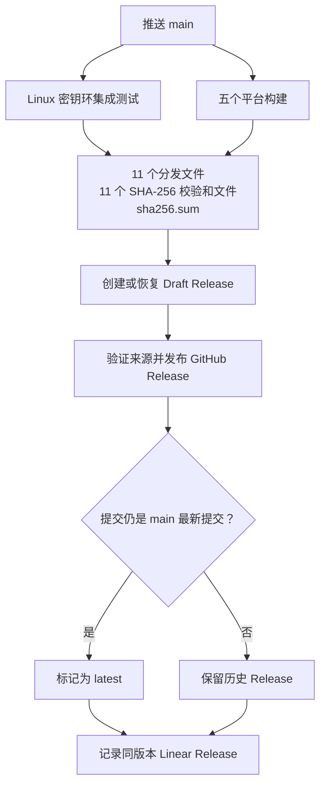

# 主分支发布

## 发布契约

- `main` 受保护，发布必须经 PR squash 合并；不能直接推送或绕过保护规则。
- 在版本控制中将 `deno.json` 保持为 `0.0.0-dev`。
- `.github/workflows/ship-main.yml` 根据推送的提交生成 `0.0.<commit timestamp>-g<short commit>`。
- 每次 `main` 更新都会进入串行发布队列。运行成功后会自动创建 tag 和 GitHub Release。
- 发布任务不会取消已经在运行的任务，队列最多保留 100 个等待中的任务。
- 不要手动递增版本、创建发布 tag 或推送 tag。

## 准备

1. 确认 `origin` 为 `https://github.com/jihuanshe/linear`，获取 `origin/main`，在工作分支准备发布内容。产品改动已合并但未发布时，可用空发布提交建立发布准备 PR。
2. 在第一次提交前检查实际生效的提交身份：

   ```bash
   git config --show-origin --get user.name
   git config --show-origin --get user.email
   ```

3. 提交所有计划中的变更。将无关事项放在不同提交中。
4. 核对相对 `origin/main` 的全部改动。遇到实质性冲突时停止并先询问用户。
5. 针对最终提交运行完整的本地发布门禁：

   ```bash
   deno task verify-release
   ```

   在工作副本干净且门禁通过前不要 push。

## PR 门禁与合并

推送工作分支并创建以 `main` 为 base 的 PR。合并前核对同一个 head：

- 17 项必需检查全部通过：`Prepare source`、`Quality checks`、`Source gate`、`Executable acceptance`、`Conformance cases`、`Tests (1/12)` 至 `Tests (12/12)`。
- `Company commit identity` workflow 通过。
- Codex 和 Review Bot 没有未处理的真问题，未解决评审线程为 0，GitHub 状态为 `MERGEABLE`／`CLEAN`。

将 `pr` 设为目标 PR 编号，使用当前 PR head 锁定 squash 合并，不添加跳过 CI 的标记。合并后用合并提交 SHA 等待原有发布 workflow，不能用 PR head 推导发布版本：

```bash
head="$(gh pr view "$pr" --json headRefOid --jq .headRefOid)"
gh pr merge "$pr" --squash --match-head-commit "$head"
sha="$(gh pr view "$pr" --json state,mergeCommit --jq 'select(.state == "MERGED") | .mergeCommit.oid')"
test -n "$sha"
git fetch origin main
run_id=""
for _ in {1..12}; do
  run_id="$(
    gh run list --workflow ship-main.yml --branch main --limit 20 \
      --json databaseId,headSha \
      --jq ".[] | select(.headSha == \"$sha\") | .databaseId" | head -n 1
  )"
  [[ -n "$run_id" ]] && break
  sleep 5
done
test -n "$run_id"
gh run watch "$run_id" --exit-status
```

PR head 变化后重新核对门禁；检查或合并失败时停止并报告，不绕过保护或更换发布入口。

## CI 发布工作流



每个平台产出一个安装归档、一个独立自更新二进制和各自的 SHA-256 校验和文件。发布任务额外打包仓库根目录的 `install.sh` 和 `install.sh.sha256`，并将脚本纳入 `sha256.sum` 与来源证明。GitHub Release 只有在对应提交仍是当前 `main` 最新提交时才标记为 `latest`，防止较早的排队任务把安装目标倒退到旧版本。Linear Release 使用准确的 `before..HEAD` 推送范围；其 ID 和 URL 必须非空，版本必须与 GitHub Release 一致。

## 发布后验证

根据合并提交 `$sha` 推导预期版本，并检查该确切 Release：

```bash
timestamp="$(git show -s --format=%ct "$sha")"
version="0.0.${timestamp}-g$(printf '%s' "$sha" | cut -c1-7)"
gh release view "$version" \
  --json tagName,targetCommitish,isDraft,isPrerelease,url,assets
git fetch origin main
if [[ "$(git rev-parse origin/main)" == "$sha" ]]; then
  test "$(gh api repos/jihuanshe/linear/releases/latest --jq .tag_name)" = "$version"
fi
```

必须确认该 Release 指向合并提交、已经发布且不是预发布版本。如果合并提交仍是当前 `main` 的最新提交，还必须确认它是 `latest`。它必须包含 23 个文件：10 个二进制／归档、`install.sh`、11 个独立校验和文件以及 `sha256.sum`。匿名下载该确切 tag 的 `install.sh` 和 `install.sh.sha256` 并校验；再确认 `releases/latest/download/` 下这两个资产可匿名下载。

如果 mise 可用，验证公开安装解析出的版本是否符合预期：

```bash
actual="$(mise x "github:jihuanshe/linear[minimum_release_age=0s]@$version" -- linear --version)"
test "$actual" = "linear $version"
```

`minimum_release_age=0s` 仅对本工具绕过 mise 默认的 24 小时 Release 等待时间。

## 失败处理

- 本地源码检查、CI 密钥环集成检查或构建失败时停止并报告；修复通过新 PR 进入 `main`。
- 被取消的任务不算已发布 Release，可能会留下不可见的 Draft。`main` 前进后不要重新运行它；如有需要，之后再清理。
- 已完成的历史 Release 保持不可变且可下载。
- 如果 GitHub 拒绝写入权限、证明或 Release 创建，报告阻塞它的仓库设置，不要改用个人 token 或私有 runner。
